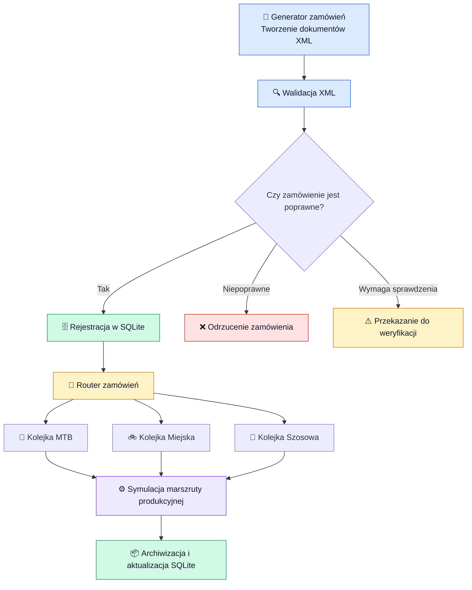

# 🚲 System cyfrowej obsługi zamówień i symulacji marszruty produkcyjnej rowerów

## 📌 1. Cel projektu

Celem projektu jest opracowanie systemu informatycznego wspomagającego obsługę zamówień oraz sterowanie przepływem produkcji rowerów w przykładowym zakładzie produkcyjnym.

System automatyzuje proces od momentu wygenerowania zamówienia przez klienta, poprzez jego walidację, rejestrację w bazie danych i skierowanie do odpowiedniej kolejki produkcyjnej, aż po symulację procesu wytwarzania i archiwizację dokumentacji.

Głównym założeniem jest odwzorowanie działania cyfrowego systemu routingu, który na podstawie danych zamówienia decyduje, do jakiego procesu produkcyjnego powinno ono trafić.

---

## 🛠️ 2. Architektura i wykorzystane technologie

Projekt został podzielony na niezależne moduły realizujące konkretne zadania.

| Technologia | Zastosowanie |
|---|---|
| **Python** | Logika systemu, routing i symulacja produkcji |
| **XML** | Format wymiany danych o zamówieniach |
| **SQLite** | Przechowywanie zamówień, rowerów i historii operacji |
| **DOM (`xml.dom.minidom`)** | Odczyt i walidacja struktury dokumentów XML |
| **System plików** | Kolejkowanie, przekazywanie i archiwizacja dokumentów |

System wykorzystuje architekturę modułową. Poszczególne etapy przetwarzania są rozdzielone, dzięki czemu można je rozwijać i testować niezależnie.

---

## 🔄 3. Przebieg działania systemu

### Schemat przepływu zamówienia



### 📄 Etap 1. Generowanie zamówień

Moduł `generator.py` automatycznie tworzy zamówienia na podstawie przygotowanych słowników danych.

Losowane są między innymi:

- dane klienta,
- model roweru,
- typ roweru,
- rozmiar ramy,
- liczba zamawianych sztuk.

Każde zamówienie otrzymuje unikalny identyfikator, np. `ZAM-0187`, i zostaje zapisane jako dokument XML w katalogu `zamowienia/nowe`.

**Przykładowa struktura dokumentu:**

```xml
<?xml version="1.0" ?>
<zamowienie>
    <id>ZAM-0001</id>
    <klient>
        <imie>Piotr</imie>
        <nazwisko>Lewandowski</nazwisko>
    </klient>
    <produkt>
        <model>Giant Contend 3</model>
        <typ>Szosowy</typ>
        <rozmiar_ramy>M</rozmiar_ramy>
        <ilosc>2</ilosc>
    </produkt>
</zamowienie>
```

XML został wybrany jako format wymiany danych ze względu na jego czytelną, hierarchiczną strukturę oraz możliwość integracji z różnymi systemami.

### 🔍 Etap 2. Walidacja zamówień

Moduł `validator.py` odpowiada za sprawdzenie poprawności otrzymanych dokumentów XML.

Walidacja obejmuje między innymi:

- poprawność składni dokumentu XML,
- obecność wymaganych elementów,
- poprawność danych zamówienia,
- dopuszczalne wartości parametrów produktu.

Na podstawie wyniku walidacji dokument trafia do jednego z trzech katalogów:

| Katalog | Znaczenie |
|---|---|
| `poprawne` | Zamówienia dopuszczone do dalszego przetwarzania |
| `odrzucone` | Zamówienia zawierające błędy |
| `do_weryfikacji` | Zamówienia wymagające dodatkowej kontroli |

Dzięki temu niepoprawne dane nie trafiają bezpośrednio do procesu produkcyjnego.

### 🗄️ Etap 3. Rejestracja w bazie danych

Moduł `rejestracja.py` pobiera poprawne dokumenty XML i zapisuje ich dane w bazie `produkcja.db`.

Baza SQLite przechowuje trzy główne grupy informacji:

- **Zamówienia** – identyfikator, model, typ roweru, rozmiar, liczba sztuk, status i ścieżka do dokumentu XML.
- **Rowery** – poszczególne egzemplarze przypisane do zamówienia, ich statusy i aktualne stanowiska.
- **Operacje** – historia operacji produkcyjnych, czasy rozpoczęcia i zakończenia oraz wyniki.

Istotne jest rozdzielenie zamówienia od pojedynczego roweru. Przykładowo zamówienie na trzy rowery jest jednym rekordem w tabeli `zamowienia`, ale trzema osobnymi rekordami w tabeli `rowery`.

Pozwala to śledzić produkcję każdego egzemplarza niezależnie.

System zabezpiecza się również przed ponowną rejestracją tego samego zamówienia.

### 🔀 Etap 4. Routing zamówień

Moduł `router.py` odpowiada za cyfrowe kierowanie zamówień do odpowiednich kolejek produkcyjnych.

Na podstawie typu roweru system wybiera właściwy katalog:

| Typ roweru | Katalog docelowy |
|---|---|
| MTB | `produkcja/kolejki/MTB` |
| Miejski | `produkcja/kolejki/Miejski` |
| Szosowy | `produkcja/kolejki/Szosowy` |

Router nie przenosi wszystkich zamówień znajdujących się w bazie. Przekazuje wyłącznie te, które zostały zarejestrowane i nie zostały jeszcze przekazane do produkcji.

Informacja o przekazaniu jest dodatkowo zapisywana w SQLite.

Dzięki temu możliwe jest odróżnienie zamówień oczekujących na routing od tych, które już trafiły do produkcji.

### ⚙️ Etap 5. Symulacja marszruty produkcyjnej

To najważniejsza część projektu.

Moduł `symulacja.py` odwzorowuje przebieg produkcji rowerów w zakładzie. Nie jest to jedynie przenoszenie dokumentów pomiędzy katalogami – system symuluje rzeczywiste przechodzenie poszczególnych egzemplarzy przez stanowiska produkcyjne.

Przyjęta marszruta obejmuje osiem stanowisk:

#### 🏭 Stanowiska produkcyjne

| Lp. | Stanowisko | Opis | Liczba zasobów | Czas operacji |
|---:|---|---|---:|---:|
| 1 | Kompletacja | Przygotowanie części i komponentów | 2 | 8–12 min |
| 2 | Cięcie i obróbka rur | Przygotowanie elementów konstrukcyjnych ramy | 2 | 10–16 min |
| 3 | Spawanie ramy | Łączenie elementów ramy roweru | 1 | 15–22 min |
| 4 | Szlifowanie | Obróbka powierzchni i przygotowanie do lakierowania | 2 | 8–12 min |
| 5 | Lakiernia | Malowanie i wykończenie ramy | 2 | 20–30 min |
| 6 | Montaż końcowy | Montaż pozostałych komponentów roweru | 3 | 20–30 min |
| 7 | Kontrola jakości | Weryfikacja poprawności wykonania roweru | 1 | 8–12 min |
| 8 | Pakowanie i wysyłka | Przygotowanie gotowego roweru do przekazania klientowi | 2 | 5–8 min |

Każde stanowisko ma określoną liczbę dostępnych zasobów oraz losowany czas realizacji operacji z ustalonego przedziału.

Symulacja wykorzystuje mechanizm zdarzeń i kolejek. Dzięki temu poszczególne rowery mogą znajdować się na różnych etapach produkcji w tym samym czasie, a ograniczona liczba zasobów wpływa na oczekiwanie na wykonanie operacji.

#### 🛠️ Kontrola jakości i naprawy

Po zakończeniu montażu rower trafia do kontroli jakości.

System uwzględnia możliwość wykrycia usterki, np.:

- problemów z hamulcami,
- nieprawidłowości w napędzie,
- luzów w elementach konstrukcyjnych.

W przypadku wykrycia problemu rower trafia na stanowisko poprawek, a następnie ponownie przechodzi kontrolę jakości. Liczba poprawek jest ograniczona. Po przekroczeniu limitu rower może zostać odrzucony.

W ten sposób symulacja odwzorowuje nie tylko idealny przebieg produkcji, ale również sytuacje wymagające interwencji.

### 📦 Etap 6. Archiwizacja

Po zakończeniu produkcji system sprawdza status wszystkich rowerów należących do danego zamówienia.

W zależności od wyniku cały dokument XML trafia do odpowiedniego katalogu:

| Wynik zamówienia | Katalog docelowy |
|---|---|
| Wszystkie rowery gotowe | `produkcja/zrealizowane/{typ}` |
| Wszystkie rowery odrzucone | `produkcja/odrzucone/{typ}` |
| Część gotowa, część odrzucona | `produkcja/czesciowo_zrealizowane/{typ}` |

Jednocześnie baza SQLite otrzymuje końcowy status zamówienia, datę zakończenia, czas realizacji oraz aktualną ścieżkę do dokumentu XML.

Zastosowano również mechanizm obsługi błędów archiwizacji. Jeśli przeniesienie dokumentu się nie powiedzie, system zapisuje odpowiedni status i może ponowić operację przy kolejnym uruchomieniu.

---

## 📊 4. Przykładowy wynik działania

Podczas przeprowadzonego testu system przetworzył 13 zamówień obejmujących łącznie 26 rowerów.

Uzyskano następujące wyniki:

| Parametr | Wynik |
|---|---:|
| Przetworzone zamówienia | **13** |
| Wyprodukowane rowery | **26** |
| Gotowe rowery | **26** |
| Odrzucone rowery | **0** |
| Przeprowadzone kontrole jakości | **27** |
| Wykryte usterki | **1** |
| Wykonane naprawy | **1** |
| Błędy archiwizacji | **0** |
| Czas symulowanej produkcji | **583,03 min** |

Warto zauważyć, że liczba kontroli jakości jest większa niż liczba rowerów, ponieważ jeden egzemplarz musiał przejść kontrolę ponownie po wykryciu usterki.

### Wyniki kontroli jakości

```text
Liczba kontroli:       27
Wykryte usterki:        1
Wykonane naprawy:       1
```

Wszystkie 26 rowerów uzyskało status gotowego produktu, a wszystkie 13 zamówień zostało prawidłowo zarchiwizowanych.

---

## ⭐ 5. Najważniejsze zalety rozwiązania

- **Automatyzacja** – ograniczenie ręcznego przekazywania zamówień pomiędzy etapami.
- **Modułowość** – poszczególne elementy systemu można rozwijać niezależnie.
- **Kontrola poprawności danych** – walidacja XML przed rejestracją i produkcją.
- **Śledzenie produkcji** – możliwość monitorowania każdego egzemplarza roweru.
- **Odwzorowanie ograniczeń produkcyjnych** – stanowiska mają określoną przepustowość.
- **Obsługa błędów jakościowych** – możliwość wykrywania usterek i wykonywania poprawek.
- **Trwałość danych** – informacje o zamówieniach i operacjach są przechowywane w bazie SQLite.
- **Odporność na ponowne uruchomienie** – system rozpoznaje już zarejestrowane i przekazane zamówienia oraz obsługuje ponawianie archiwizacji.

---

## 📁 6. Struktura projektu

```text
Marszruta/
│
├── generator.py
├── validator.py
├── database.py
├── rejestracja.py
├── router.py
├── symulacja.py
├── produkcja.db
│
├── zamowienia/
│   ├── nowe/
│   ├── poprawne/
│   ├── odrzucone/
│   └── do_weryfikacji/
│
└── produkcja/
    ├── kolejki/
    │   ├── MTB/
    │   ├── Miejski/
    │   └── Szosowy/
    │
    ├── zrealizowane/
    │   ├── MTB/
    │   ├── Miejski/
    │   └── Szosowy/
    │
    ├── odrzucone/
    │   ├── MTB/
    │   ├── Miejski/
    │   └── Szosowy/
    │
    └── czesciowo_zrealizowane/
        ├── MTB/
        ├── Miejski/
        └── Szosowy/
```

---

## 🎯 7. Podsumowanie

Projekt przedstawia kompletny przepływ obsługi zamówienia w przykładowym zakładzie produkcyjnym – od wygenerowania dokumentu XML, przez walidację, rejestrację i routing, aż po symulację produkcji oraz archiwizację.

Najważniejszym elementem rozwiązania jest połączenie mechanizmu integracji danych z symulacją marszruty produkcyjnej. Dzięki temu możliwe jest nie tylko przekazywanie zamówień do odpowiednich kolejek, ale również odwzorowanie przebiegu produkcji z uwzględnieniem ograniczonych zasobów, czasu operacji i kontroli jakości.

**Uwaga:** czasy operacji, liczba zasobów i prawdopodobieństwo wystąpienia usterek są parametrami przyjętego modelu symulacyjnego, a nie danymi pochodzącymi z rzeczywistego zakładu produkcyjnego.